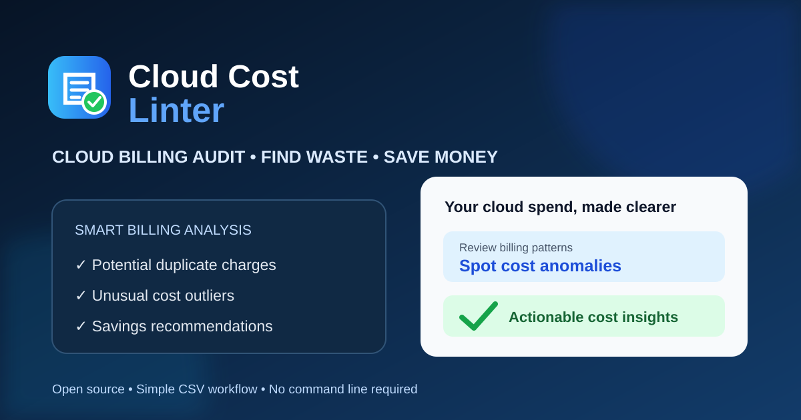

# Cloud Cost Linter

<p align="center">
  
</p>

**Analyze cloud billing CSVs. Spot unusual spending and potential duplicate charges.**

Cloud Cost Linter is a lightweight Python tool for reviewing cloud billing exports. It summarizes spending, flags statistical outliers, identifies possible duplicate entries for manual review, and provides illustrative rightsizing estimates.

[](LICENSE)
[](https://www.python.org/)
[](https://github.com/ashrafhashmi95786-sys/cloud-cost-linter/releases/latest)

**Latest release:** [v1.0.1 — Improved Error Handling](https://github.com/ashrafhashmi95786-sys/cloud-cost-linter/releases/tag/v1.0.1)

## Core features

- **Potential duplicate detection:** finds matching billing entries that may deserve investigation.
- **Cost anomaly detection:** uses statistical analysis to flag unusually high spending.
- **Spending breakdown:** summarizes costs by cloud service.
- **Illustrative rightsizing estimates:** provides heuristic estimates for selected high-cost entries.
- **Local CLI analysis:** the command-line tool processes billing CSV files on your machine without sending them to a server.
- **No third-party Python dependencies:** uses the Python standard library.

## Important financial disclaimer

Cloud Cost Linter provides analysis and illustrative estimates, not guaranteed savings or financial advice.

For the included sample billing data:

| Category | Amount | Explanation |
| --- | ---: | --- |
| Illustrative rightsizing estimate | $3,308 | Heuristic estimate requiring technical verification |
| Candidate duplicate charges | $299 | Unconfirmed entries requiring provider investigation |
| Verified savings | $0 | No actual savings have been confirmed |

These are separate categories. Do not add them together or describe them as realized savings.

### Rightsizing estimate assumptions

The sample estimate uses a 40% modeling assumption:

- GPU instance: $4,820 × 40% = $1,928
- Storage volume: $3,450 × 40% = $1,380
- Total illustrative rightsizing estimate: $3,308

The 40% reduction is an assumption, not a verified saving.

### Important limitations

- Billing records alone cannot establish whether a resource is idle or active.
- CPU, memory, IOPS, and other runtime metrics are needed to assess utilization.
- Matching billing entries may be legitimate charges.
- Potential duplicates are not confirmed refunds.
- Actual savings require independent technical and financial verification.

## Requirements

- Python 3.7 or later
- No third-party Python packages required

## Installation

Clone the repository:

```bash
git clone https://github.com/ashrafhashmi95786-sys/cloud-cost-linter.git
cd cloud-cost-linter
```

Alternatively, download and extract the [latest release](https://github.com/ashrafhashmi95786-sys/cloud-cost-linter/releases/latest).

## Quick start

### Analyze the sample billing data

```bash
python3 cloud_cost_linter.py sample_billing.csv
```

### Generate JSON output

```bash
python3 cloud_cost_linter.py sample_billing.csv --json
```

### Adjust anomaly sensitivity

```bash
python3 cloud_cost_linter.py sample_billing.csv --threshold 1.5
```

### Start the local web interface

```bash
python3 cloud_cost_linter.py --serve
```

Alternatively:

```bash
python3 cloud_cost_linter_web.py
```

Open the local address shown by the server. The default standalone address is:

```text
http://127.0.0.1:8080
```

### Hosted web demo

Try the hosted demo: **https://cloud-cost-linter.onrender.com**

The hosted web app supports:

- Uploading cloud billing CSV files.
- Viewing spending summaries.
- Reviewing potential duplicate charges and unusual spending.
- Exporting analysis reports as CSV and JSON.
- Starting a fresh analysis with **Analyze Another CSV**.

**Hosted demo privacy:** When you use the hosted demo, the selected CSV is sent to the server for temporary in-memory processing. Do not upload confidential, sensitive, or customer-identifying billing data. The demo does not require cloud account credentials.

## Local web interface

You can also run the web interface on your own machine using the instructions above. The standalone local interface processes files on your machine. Do not expose a locally running server to the public internet without an independent security review.

## Sample billing analysis

The included sample dataset contains 20 billing records.

Reported sample results:

| Metric | Sample result |
|---|---:|
| Total spending | $11,575.75 |
| Potential duplicate entries | 2 |
| Candidate duplicate charges | $299 |
| Statistical cost outliers | 2 |
| Illustrative rightsizing estimate | $3,308 |
| Verified savings | $0 |

These figures describe the included sample only. They are not guaranteed financial results.

## CSV format

The input CSV must include these columns:

| Column | Description | Example |
|---|---|---|
| `record_id` | Billing record identifier | `rec_1001` |
| `service` | Cloud service name | `Compute Engine` |
| `resource_id` | Resource identifier | `instance-api-01` |
| `date` | Billing entry date | `2026-10-01` |
| `cost` | Billing amount | `142.50` |

Optional columns may include `region` and `description`.

See [sample_billing.csv](sample_billing.csv) for an example.

## Running automated tests

Run the test suite with:

```bash
python3 -m unittest test_cloud_cost_linter.py -v
```

The latest recorded local test run completed **31 tests successfully**. Run the command above on your checkout to verify its current state.

## Project files

- `cloud_cost_linter.py` — Main command-line tool
- `cloud_cost_linter_web.py` — Standalone local web interface
- `sample_billing.csv` — Example billing dataset
- `test_cloud_cost_linter.py` — Automated Python tests
- `README.md` — Project documentation
- `LICENSE` — MIT License

## Privacy and security

- No cloud account credentials are required for CSV analysis.
- The command-line tool and standalone local web interface are designed to analyze files locally.
- The hosted demo sends the uploaded CSV to the server for temporary in-memory processing; avoid uploading confidential or sensitive billing data.
- Review billing files before using or sharing them.
- Never include passwords, API keys, access tokens, or private customer information in shared files or bug reports.
- Independently review security before processing sensitive financial data or exposing the web interface to another network.

## Contributing

Suggestions, bug reports, and improvements are welcome. Please open a [GitHub Issue](https://github.com/ashrafhashmi95786-sys/cloud-cost-linter/issues) or submit a Pull Request.

## License

This project is released under the [MIT License](LICENSE).

---

**Cloud Cost Linter — Analyze spending. Find anomalies. Make informed decisions.**
